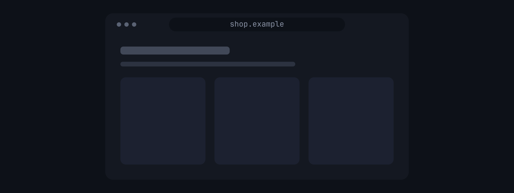

# Browser

A browser window to put an interface inside, in [browser.py](browser.py): a panel with three dots and an address in a pill, and a screen area below for whatever the scene builds. Use it to show a web page, a request made from one, or a page changing as an address does.

Copy `browser.py` and the skill's `code_font.py` next to the scene.

```python
from browser import Browser

b = Browser("shop.example")
self.play(b.draw())                          # the window fades in, rising
self.play(b.show(shop))                      # a mobject is fitted to the screen and fades in
self.play(b.go("shop.example/cart", cart))   # the address changes, a bar runs across under
                                             # the toolbar and the page is swapped
```



The grey bars and cards in the picture are a placeholder page made in `examples.py`. The browser draws only the window.

## Pages

A page is any mobject: a `VGroup` of shapes and text, an image, one of the other components. `b.screen` is an invisible rectangle over the area a page may fill, so build pages to `b.screen.width` and `b.screen.height`.

- **`b.place(page)`** fits a page to the screen without animating: it is shrunk if it is too big (never enlarged) and put in the top left corner. Use it with `self.add(b, b.place(page))` for a window that is there from the start.
- **`b.show(page)`** places a page and returns the animation that fades it in, rising. A page already on the screen fades out first.
- **`b.go(address, page)`** goes to another address. The old address slides up and out as the new one comes in, a thin blue bar runs across under the toolbar, the old page fades out and the new one comes in from the right. Leave out `page` to change only the address, as for a redirect or a query added to the URL.

`b.content` is the page being shown. Pages are not clipped, so nothing in one should reach outside the screen, and they are not part of the browser group: to move the window with its page, move both, for example `Group(b, b.content).shift(LEFT * 2)`.

## Options

`Browser(address="", width=8.0, height=4.8, dots=True, align=UL)`

| Option | Effect |
|---|---|
| `address` | What the address bar says to begin with. The pill widens for an address too long for it. |
| `width`, `height` | The window's size. The toolbar keeps its height whatever these are. |
| `dots` | `False` leaves out the three dots. |
| `align` | Where a page smaller than the screen is put: `UL` is the top left corner, `UP` centred against the top, `ORIGIN` the middle. |

`b.draw()` is the entrance; `FadeIn(b)` also works. Every move takes `run_time`. The window can be resized with `scale` before pages are placed. `b.panel`, `b.dots`, `b.pill` and `b.address` are its parts.

## Regenerating the image

```bash
manim render -s -r 2400,900 --disable_caching --media_dir /tmp/manim/browser -o browser examples.py Still
cp /tmp/manim/browser/images/examples/browser.png images/
```

`examples.py` also has `Demo`, which opens a window, shows a page, goes to a second, changes only the address, and goes back.
