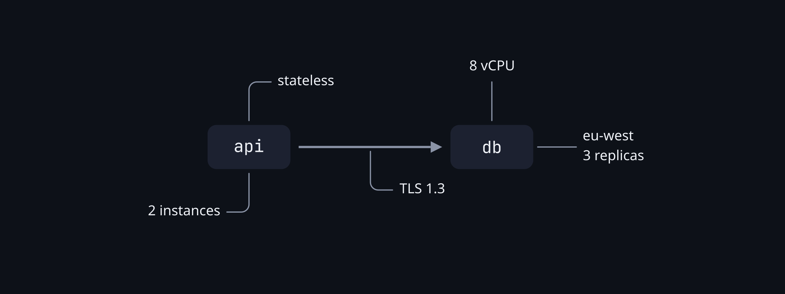

# Callout

A callout, in [callout.py](callout.py): a short label joined to the thing it describes by a thin line that leaves the thing, turns once and ends at the words. Use it to annotate a diagram without adding to it: a note on a node, a figure on a link, a name for a point on a chart.

Copy `callout.py` next to the scene.

```python
from callout import Callout

note = Callout(api, "stateless")                     # up from the top of `api`, then right
self.play(note.draw())                               # the line grows out, then the words
self.play(note.erase())                              # ...and back again

Callout(link.point(0.5), "TLS 1.3", side=DOWN)       # a point works as well as a mobject
Callout(db, "primary", side=DOWN, turn=LEFT)         # down, then left
Callout(db, "eu-west\n3 replicas", side=RIGHT)       # straight out sideways, two lines
Callout(db, "8 vCPU", turn=False)                    # straight up, the words above
```



## What it does

- **The line** starts a little outside the target, runs `rise` in the direction of `side`, turns through a quarter circle and runs `run` more. It has no dot or arrowhead.
- **The words** sit just beyond the end of the line: beside it when the line ends sideways, centred above or below it when the line ends going up or down.
- **`draw()`** grows the line out from the target, then slides the words in from its end. **`erase()`** is the same in reverse and takes the callout off the scene. `self.add(note)` or `FadeIn(note)` also work.

## Options

`Callout(target, text, side=UP, turn=None, rise=0.7, run=0.4, at=0.5, follow=False, color=MUTED, text_color=INK, size=1.0)`

| Option | Effect |
|---|---|
| `target` | A mobject, or a point such as `link.point(0.5)` or `dot.get_center()`. |
| `text` | A word or a few. `"\n"` starts a second line. |
| `side` | The side of the target the line leaves from: `UP`, `DOWN`, `LEFT` or `RIGHT`. |
| `turn` | The direction the line turns to. By default a line that leaves up or down turns `RIGHT`, and one that leaves sideways does not turn. `False` is a straight line whatever its side. It must be at right angles to `side`. |
| `rise`, `run` | How far the line goes before the turn, and after it. Lengthen `rise` to lift one callout clear of another. |
| `at` | Where on the target's side the line starts: 0.5 is the middle, 0 and 1 the ends (left to right, or bottom to top). |
| `follow` | `True` keeps the callout attached while its target moves. Without it the callout stays where it was made. |
| `color`, `text_color` | The line's color and the words'. |
| `size` | Scales the words and the line's weight, for a diagram drawn larger or smaller than usual. |
| `buff`, `corner` | The gap between the target and the line (0.08), and the radius of the turn (0.14). |

A callout is placed by its target and these options: change `side`, `turn`, `rise` and `at` to move it, not `shift`. `callout.line` and `callout.label` are its parts.

Keep the text short. A callout names or qualifies one thing; a sentence belongs in a caption.

## Regenerating the image

```bash
manim render -s -r 2400,900 --disable_caching --media_dir /tmp/manim/callout -o callout examples.py Still
cp /tmp/manim/callout/images/examples/callout.png images/
```

`examples.py` also has `Demo`, which draws five callouts on a two-box diagram, erases them, and moves a box with its callout attached.
