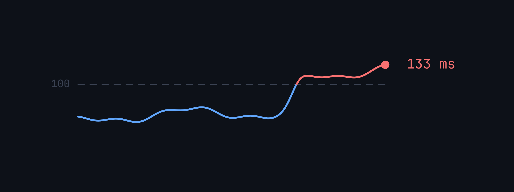

# Chart

A live chart, in [chart.py](chart.py): one metric as a line that scrolls past, with the reading written at its head. Given a threshold, the line, its head and the reading turn red wherever the metric is over it.

Copy `chart.py` and the skill's [code_font.py](../../code_font.py) next to the scene:

```python
from chart import chart

latency = ValueTracker(45)
c = chart(latency, limit=100, unit=" ms")
self.add(c)                                               # fades in, already showing a few seconds of history
self.wait(2)                                              # it scrolls by itself
self.play(latency.animate.set_value(130), run_time=1.5)   # the line climbs, and turns red over 100
self.wait(2)
```



The chart keeps its own clock and reads its source every frame, so it runs during `wait` as well as `play`. Change the metric by animating the tracker; the line follows.

- **Bringing it in.** Add it with `self.add(c)`: it fades itself in over `fade_in` seconds. Don't use `FadeIn` on it, which fails because the chart redraws itself every frame. To take it away, `self.remove(c)` or cover it.
- **History from the start.** The chart is made with a full window of history at the starting value, so it never begins empty.
- **A live look.** A tracker held steady would draw a flat line, so the chart adds a small waver of its own. `jitter=0` turns that off and draws the source exactly.
- **Over the limit.** The line is cut exactly where it crosses the limit, so each stretch is one color: the chart's color under it and red over it.

## Options

`chart(source, limit=None, top=None, window=6.0, width=5.5, height=1.6, unit="", jitter=0.1, color=BLUE, fade_in=0.4)`

| Option | Effect |
|---|---|
| `source` | A `ValueTracker` holding the metric; or a function of the chart's own clock, in seconds, that returns it. Negative times are the history the chart starts with. |
| `limit` | The threshold: a dashed line across the chart, labelled at its left end. `None` leaves it out, and nothing turns red. |
| `top` | The value at the top of the chart; the bottom is 0. By default 1.6 times the limit, or 2.5 times the starting value. The line is held at the top if the metric goes past it. |
| `window` | How many seconds of history the chart shows. |
| `width`, `height` | The size of the plot. The text and line weights follow the height. The reading needs about one more unit of room to the right. |
| `unit` | Written after the reading: `" ms"`, `"%"`, `" req/s"`. |
| `jitter` | How much the line wavers by itself, as a share of `top`. |
| `color` | The line's color where it is under the limit. |
| `fade_in` | Seconds the chart takes to fade in once added. 0 shows it at once. |

Place the chart with `move_to`, `next_to` or `shift`. Don't `scale` it: the next redraw undoes that. It has no title or axes; put a `Text` beside it to name the metric.

## Regenerating the image

```bash
manim render -s -r 2400,900 --disable_caching --media_dir /tmp/manim/chart -o chart examples.py Still
cp /tmp/manim/chart/images/examples/chart.png images/
```

`examples.py` also has `Demo`, in which a tracker is raised over the limit and brought back down.
