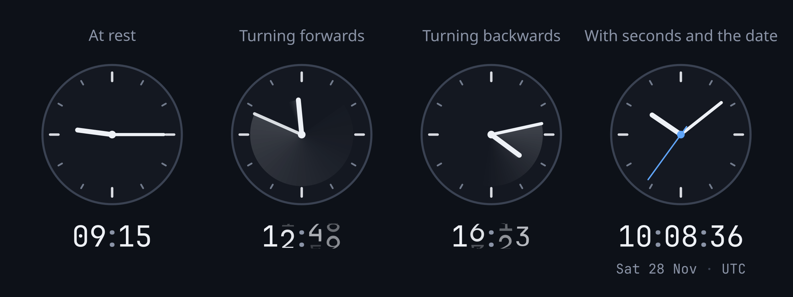

# Clock

An analog clock with the time in 24-hour digits below it, in [clock.py](clock.py). It can be turned forwards and backwards: the hands spin through every hour in between and the digits turn over on wheels. A second line can show the weekday, the date and the time zone.

Copy `clock.py` and the skill's [code_font.py](../../code_font.py) next to the scene:

```python
from clock import Clock

clock = Clock("09:15", date="2026-11-28", weekday=True, zone="UTC")
self.add(clock)
self.play(clock.to("17:40"))            # on to the next 17:40: the hands spin clockwise
self.play(clock.back(hours=3))          # back three hours: they spin the other way
self.play(clock.forward(hours=12))      # past midnight: the weekday and the date turn over too
```



## Turning it

Each of these returns an animation to `play`:

| Call | Effect |
|---|---|
| `clock.to("17:40")` | Forwards to the next 17:40. `forward=False` goes back to the last one. `days=2` adds two whole days to the journey. |
| `clock.forward(hours=3, minutes=20)` | Forwards by that much. Takes `days`, `hours`, `minutes` and `seconds`. |
| `clock.back(hours=3)` | Backwards by that much, with the same options. |
| `clock.to_zone("JST", hours=9)` | Changes the time zone shown, turning the clock by the hours the new zone is ahead of the old one (negative if it is behind). |

`clock.set("17:40")` shows a time at once, with no animation.

While the clock turns:

- **The hands** sweep through all the time in between, clockwise going forwards and anticlockwise going backwards. Each leaves a trail of its own color behind it, longer the faster it moves. When the minute hand turns too fast to follow, its trail evens out into a disc and the hour hand carries the motion.
- **The digits** each sit on a wheel. A digit about to change goes up and over the top of its wheel, flattening and darkening as it turns away, while the next comes up from below. Going backwards the wheels turn the other way. A digit changing too fast to read is shown as its wheel spinning. As the clock slows, the last few minutes turn over one at a time.
- **The weekday and the date** turn over the same way as the clock passes midnight, in either direction. Months and years follow the calendar.

The move eases in and out and takes between 1 and 3 seconds, longer for a longer journey. Pass `run_time` or `rate_func` to change that. Each move starts from wherever the clock is when it begins, so moves can be played one after another or queued in a `Succession`.

## Options

`Clock(time="12:00", radius=1.0, date=None, weekday=False, year=False, zone=None, seconds=False, digital=True, color=BLUE, rate=0.0)`

| Option | Effect |
|---|---|
| `time` | The starting time: `"17:40"`, `"17:40:30"` or `(17, 40)`. |
| `radius` | The size of the face. The digits scale with it. |
| `date` | The date the clock starts on, `"2026-11-28"` or a `datetime.date`. Shown as `28 Nov`. |
| `weekday` | `True` shows the weekday of `date` before it. To show a weekday with no date, name the day the clock starts on: `weekday="Sat"`. |
| `year` | `True` adds the year to the date. |
| `zone` | The name of the time zone, shown at the end of the line: `"UTC"`, `"PST"`, `"UTC+9"`. It is a label only: the clock does no time zone arithmetic of its own. |
| `seconds` | Adds a second hand and seconds to the digits. |
| `digital` | `False` leaves out everything below the face. |
| `color` | The color of the second hand. |
| `rate` | Seconds of clock time per second of video while nothing else is turning the clock. The default 0 is a stopped clock; 1 keeps real time; 60 passes a minute each second. It can be changed at any time: `clock.rate = 1`. |

The weekday, date and zone share one smaller line under the time, as in `Sat 28 Nov · UTC`. Leave all three out and there is no second line. Give the clock a `zone` when you make it if you will call `to_zone` later, so that room is kept for the line.

`clock.minutes` is a `ValueTracker` holding minutes since midnight on the starting date, for motion of your own: `self.play(clock.minutes.animate.increment_value(90), rate_func=linear)`.

All the text is set in the skill's code font. Place the clock with `move_to`, `next_to` or `shift`. Don't `scale` it: the next redraw undoes that, so set `radius` instead. `FadeIn` and `FadeOut` work: the clock holds still while it fades, and a running clock carries on from the same time afterwards.

## Regenerating the image

```bash
manim render -s -r 2400,900 --disable_caching --media_dir /tmp/manim/clock -o clock examples.py Still
cp /tmp/manim/clock/images/examples/clock.png images/
```

`examples.py` also has `Demo`, which plays each kind of move and a clock keeping real time.
