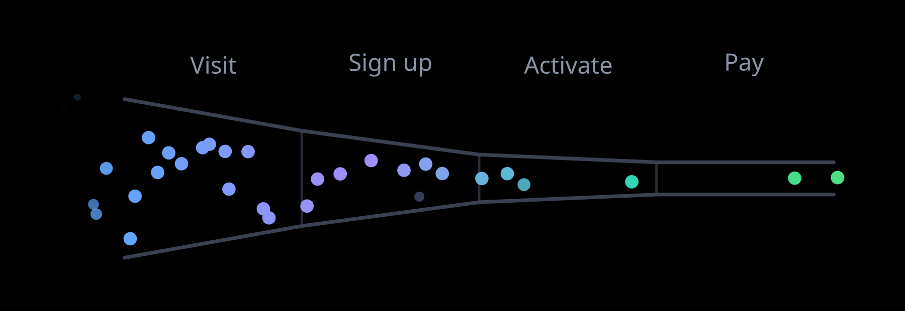

# Funnel

A funnel that dots flow through, thinning out at each stage, in [funnel.py](funnel.py). It shows a process that loses some of what enters it at every step: sign-ups, filtering, a hiring pipeline.

Copy `funnel.py` next to the scene:

```python
from funnel import funnel

f = funnel([("Visit", 0.6), ("Sign up", 0.5), ("Activate", 0.6), ("Pay", 1.0)])
self.add(f)         # already full of dots, and flowing
self.wait(8)        # it runs by itself
```



Each stage is `(name, kept)`, where `kept` is the share of the dots entering that stage that get through it. A bare name is a stage that loses nothing. The walls narrow in the same proportion, so the shape is a true funnel chart: above, 60% of visitors reach "Sign up" and the funnel is 60% as tall there.

What the dots do:

- **Entering.** A dot fades and grows in just outside the wide end and closes up into the mouth.
- **Color.** A dot takes its color from where it is along the funnel, blending smoothly through `colors` from the wide end to the narrow end.
- **Lost.** A dot that is lost keeps travelling while it fades and shrinks, and is gone before the end of the stage that lost it. It never leaves the funnel.
- **Through.** A dot that reaches the narrow end swells, brightens, and bursts into a ring.

Which dots are lost, and where, is fixed, so the funnel looks the same on every render.

`funnel(stages, width=5.8, height=1.3, colors=(BLUE, VIOLET, TEAL, GREEN), rate=9.0, speed=0.9, dot=0.055, label_size=14, filled=True)`

| Option | Effect |
|---|---|
| `width`, `height` | The funnel's length, and its height at the wide end. |
| `colors` | Two or more colors the dots pass through. |
| `rate`, `speed` | Dots entering per second, and how fast they travel in units per second. |
| `dot` | A dot's radius. The narrow end is never tighter than a dot can pass. |
| `filled` | The funnel starts with dots already all along it, so it is in full flow from the first frame. `False` starts it empty; it then takes `width / speed` seconds to fill. |

Place it with `move_to`, `next_to` or `shift`. Don't `scale` it: the next redraw undoes that. Set its size with `width`, `height`, `dot` and `label_size`.

## Regenerating the image

```bash
manim render -s -r 1800,620 --disable_caching --media_dir /tmp/manim/funnel -o funnel examples.py Still
cp /tmp/manim/funnel/images/examples/funnel.png images/
```

`examples.py` also has `Demo`, the funnel running.
