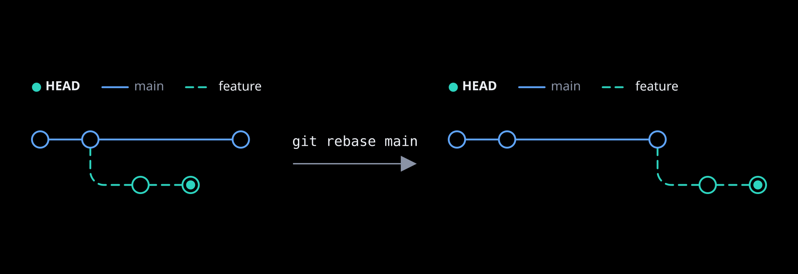
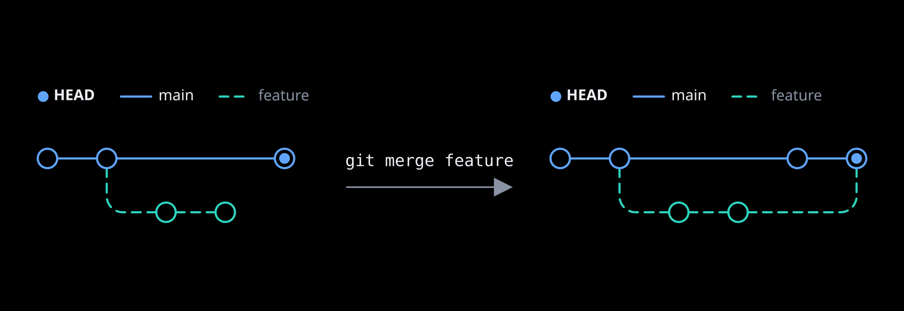
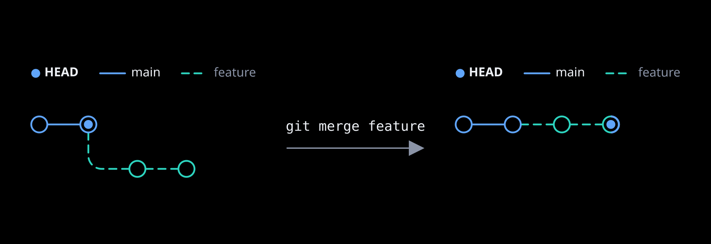
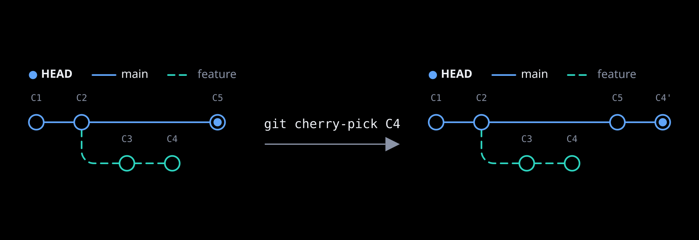
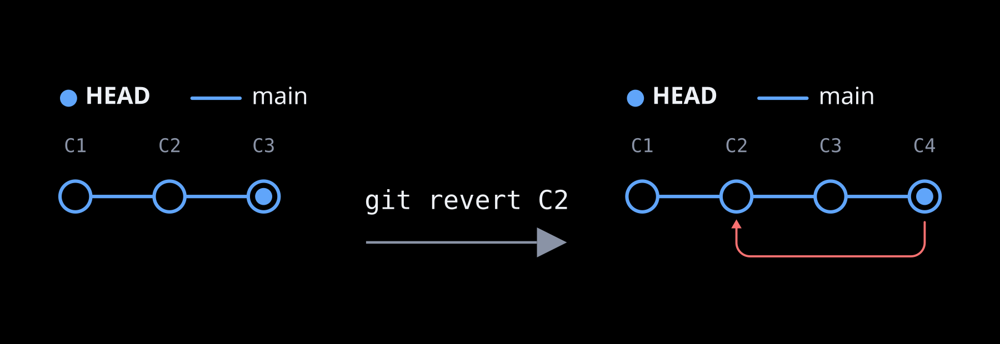
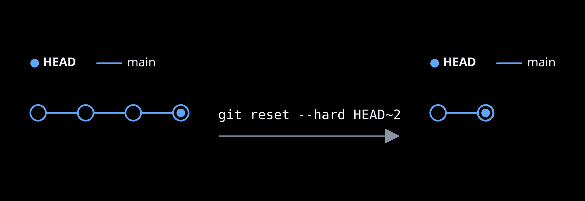
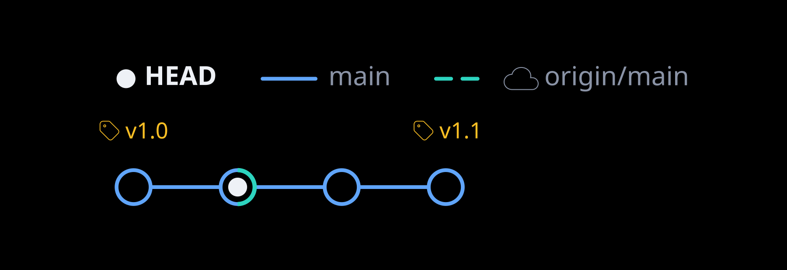

# Git graphs

An animated model of a Git history, in [git_graph.py](git_graph.py). You drive it with Git operations, and it animates each change: commits sliding out of their parents, branch pointers and HEAD moving along the history, a rebased chain travelling to its new base in one piece, and commits that nothing reaches any more fading away.

Copy `git_graph.py` and the skill's [icons.py](../../icons.py) next to the scene:

```python
from git_graph import GitGraph

g = GitGraph()                                 # on "main", first commit at `origin`
self.play(g.commit())
self.play(g.commit())
self.play(g.checkout("feature", create=True))  # git switch -c feature
self.play(g.commit())
self.play(g.checkout("main"))
self.play(g.merge("feature"))                  # fast-forward, or a merge commit
self.play(Indicate(g.node("HEAD~1")))          # one commit
```

Each operation changes the model at once and returns the animation of the change. Pass it to `self.play`, one operation per `play`. To start with history already on screen, apply the operations without animating them:

```python
g = GitGraph()
g.instant(g.commit(), g.commit(), g.branch("feature"))
self.add(g)
```

## How to read it

Nothing hangs off the commits. Every mark is on the graph itself, and the legend row names them:

- **Lanes.** Time runs left to right, one column per commit. Each branch draws its commits on a lane of its own, `main` on top, in its own color and line type: solid, dashed, dotted, dash-dot. Color and line type say the same thing twice, so the graph still reads in grayscale.
- **Branch pointers.** A branch points at the commit where its line ends, so an ordinary tip carries no extra mark. When a branch points anywhere else, that commit's ring is split: the commit keeps its own color on the left, and the branch's color takes the right half (two such branches take a third each). That happens for a new branch with no commits yet, a branch that was fast-forwarded onto another's commits, and a remote-tracking branch that is behind.
- **HEAD.** The filled dot. It takes the color of the checked-out branch, whose name is also the bright one in the legend. A detached HEAD is white.
- **Lane changes.** Every lane change is the same shape: straight along a lane, through one quarter-circle corner, straight into the commit. A branch drops out of its parent and turns onto its lane. A merge runs along its lane and turns up into the merge commit.
- **Tags** are the one label on the graph, a small amber name above the commit.

A branch gets its lane with its first commit, so a branch that never commits (`origin/main`) doesn't leave an empty row. After a fast-forward, the history is one line and is drawn as one: the merged commits move up onto the lane of the branch that caught up.

`GitGraph(origin=LEFT*5.6 + UP*1.2, spacing=1.2, lane_gap=1.0, main="main", labels=False, legend=True)` sets where the first commit goes, the column and lane spacing, the first branch's name, whether commit ids show, and the legend. About eleven commits fit across the frame at the default spacing. For longer histories, use a smaller `spacing`, or move or scale the whole graph with `g.animate.shift(...)` and `g.animate.scale(...)`. New commits follow the graph wherever it goes.

**Ids and messages.** Commits are named `C1`, `C2` and so on, and a copy made by a rebase, cherry-pick or amend gets a prime (`C3'`). They are hidden by default. Pass `labels=True` when the narration refers to commits by id (`git cherry-pick C4`), and the ids show above the commits. A `message` given to `commit` always shows. Keep it to a word or two, because it has one column of room. With labels on, use `lane_gap=1.2` to give them air.

**Legend.** The legend sits in a row above the graph and updates itself as branches come and go. Pass `legend=<point>` to put its left end elsewhere, or move it later with `g.legend.shift(...)`. `legend=False` leaves it out, for a scene that names the branches some other way.

## Operations

A revision (`rev`) can be a commit id, a branch, a tag or `HEAD`, optionally with `~n` (`"HEAD~2"`, `"main~1"`).

| Call | Git | What it shows |
|---|---|---|
| `commit(message=None, id=None, on=None)` | `git commit` | The commit slides out from under its parent along its edge, which draws in behind it, and HEAD rides along. `on="origin/main"` commits on another branch without checking it out, for someone else's work. |
| `branch(name, at="HEAD", remote=False)` | `git branch` | Half of the commit's ring takes the new branch's color, and the branch joins the legend. `remote=True` adds a cloud icon to its legend entry. |
| `checkout(target, create=False)` | `git switch`, `git checkout` | The HEAD dot hops to the branch's commit and takes its color. On a commit rather than a branch, it turns white (detached). `create=True` is `git switch -c`. `switch` is an alias. |
| `merge(name, message=None, ff=True)` | `git merge` | When it can fast-forward, HEAD slides forward along the history while the merged commits move up into the branch's lane, and half of the new tip's ring takes the branch's color. Otherwise, or with `ff=False`, a merge commit slides out and the other branch's line arrives at it at the same moment. |
| `rebase(onto)` | `git rebase` | Copies of the branch's own commits travel to the new base together. The chain stays connected, and its first edge slides along the base branch. The originals dim, then fade. Merge commits are dropped, as Git does by default. |
| `cherry_pick(rev, message=None)` | `git cherry-pick` | A copy flies from the original as its edge grows out to meet it. The original dims while the copy leaves, then comes back. |
| `revert(rev, message=None)` | `git revert` | A new commit slides out, then a thin red arrow draws back to the commit it undoes, in elbows like every other line. The arrow runs under the lane when a tag or label is in the way above. |
| `reset(rev)` | `git reset` | HEAD travels back along the history to `rev`, and the commits left behind fade. |
| `amend(message=None)` | `git commit --amend` | The commit is replaced in place, marked by a ripple. |
| `tag(name, at="HEAD")` | `git tag` | The tag's name appears above the commit. |
| `move(name, to)` | `git fetch`, `git push`, `git branch -f` | Points a branch at another commit without moving HEAD, e.g. `origin/main` after a push. |
| `delete_branch(name)` | `git branch -d` | The branch's legend entry and its share of a ring fade, and so do commits only that branch reached. |

To point at parts of the graph, use `g.node(rev)` (a commit), `g.ref(name)` (a tag's label, the HEAD dot for `"HEAD"`, or a branch's share of a ring, which is `None` while the branch's line ends at its commit), `g.legend` and `g.position(rev)` (a point on screen), for example to `Indicate`, `Circumscribe` or place a caption next to them.

## Limits

- Squash and interactive rebase are not built. A squash can be shown as `reset` followed by `commit`.
- There are no conflicts and no second repository. A remote is shown by its remote-tracking branches, moved with `move`.
- Two branches forked from the same commit share the first stretch of their drop, so one line covers the other there.
- A rebase or fast-forward leaves the columns it vacated empty. Only columns at the right end are reused.

## Examples

Before and after, from [examples.py](examples.py):








Tags, a remote-tracking branch that is behind `main`, and a detached HEAD:



## Regenerating the images

From this directory:

```bash
O=/tmp/manim/git-examples
for S in Rebase Merge FastForward CherryPick Revert Reset Refs; do
  n=$(echo $S | sed -E 's/([a-z])([A-Z])/\1-\2/g' | tr A-Z a-z)
  manim render -s -r 1800,620 --disable_caching --media_dir $O -o $n examples.py $S && cp $O/images/examples/$n.png images/
done
```

`examples.py` also has `Demo`, a 45-second story that runs through every operation with the command shown at the top:

```bash
manim render -qm --disable_caching --media_dir /tmp/manim/git-examples examples.py Demo
```
