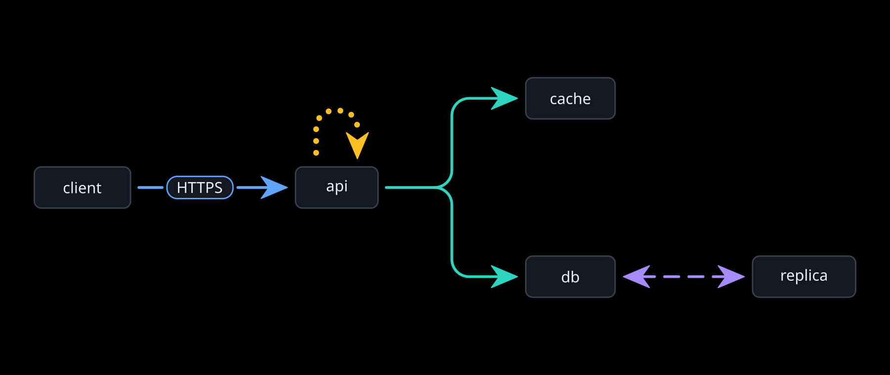
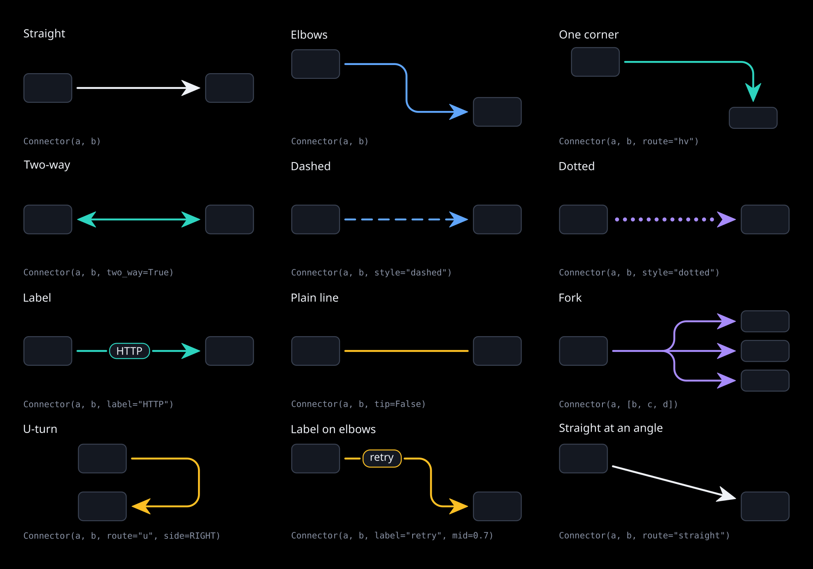

# Lines and arrows

One line for connecting things in a diagram, in [line.py](line.py). `Connector` is an arrow with a barbed tip by default, and everything else is an option: its route (straight or in elbows), dashed or dotted, two-way, labelled, forked, or turned back on itself.

Copy `line.py` next to the scene:

```python
from line import Connector

link = Connector(client, server, label="HTTPS", color=BLUE)
self.play(link.grow())            # draws in, tip leading
```



## Ends and routes

`Connector(start, end, ...)` takes mobjects or points. Between mobjects the line starts and stops `buff` (0.12) outside their edges, so build and place the mobjects first. The line is fixed once made. If its ends move, make a new one.

The line never curves freely. It runs straight, and where it has to turn, it turns through a quarter-circle elbow of radius `corner` (0.25).

| `route` | Path |
|---|---|
| `None` (default) | Straight when the ends are level with each other, otherwise `"hvh"` or `"vhv"`, whichever suits the direction. |
| `"straight"` | Directly from one end to the other, at any angle. |
| `"hvh"`, `"vhv"` | Across, a step at `mid` (0 to 1 of the way, default 0.5), and across again. `"vhv"` is the same turned on its side. |
| `"hv"`, `"vh"` | One corner: across then down (or up), or the other way round. |
| `"u"` | A U-turn. Leaves both ends on the same `side` (`RIGHT` by default), runs `reach` (0.8) beyond them and comes back. With the same mobject as both ends, it loops out of that side and back in. |

For any other path, pass `via=[point, ...]` and the line passes through those points with an elbow at each.

**Forks.** Give a list of ends, `Connector(a, [b, c, d])`, and one line leaves `a`, splits at `mid`, and runs to each end with its own tip. For lines that join instead, put the tip at the single end: `Connector(target, [x, y], tip=False, start_tip=True)`.

## Options

| Option | Effect |
|---|---|
| `style` | `"solid"`, `"dashed"` or `"dotted"`. On a single line the pattern is fitted so it ends cleanly at the tip. |
| `tip`, `start_tip`, `two_way` | `tip=False` makes a plain line. `start_tip=True` adds a tip at the start. `two_way=True` is a tip at both ends. |
| `label` | A word or two on the line, in a pill that the line breaks around. It sits in the middle of the longest straight run, or at `label_at` (0 to 1 of the way along). `label_size` and `font` set the text. |
| `color`, `width` | The line's color and stroke width (4). The label's outline takes the color too. |
| `tip_size` | Scales the tip (1.0). |

`link.grow(run_time=1.0)` is the entrance: the line draws in from its start with the tip leading and turning through each elbow. A fork's arms split at the junction and land together, a two-way line grows outward from its middle, and a label fades in as the line passes it. To show a line with no entrance, `self.add(link)`. `link.label` is the label's mobject, and `link.point(0.5)` is a point part-way along, for placing something beside the line.

Each option, with the call that draws it:



## Regenerating the images

From this directory:

```bash
O=/tmp/manim/line
manim render -s -r 2000,1400 --disable_caching --media_dir $O -o options examples.py Options
manim render -s -r 1800,760 --disable_caching --media_dir $O -o diagram examples.py Diagram
cp $O/images/examples/options.png $O/images/examples/diagram.png images/
```

`examples.py` also has `Demo`, which grows each line of the diagram in turn.
