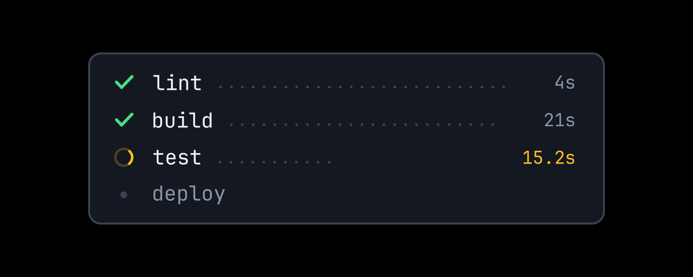

# Log

A run log, in [log.py](log.py): a list of steps that each spin while they run and get a check when done, like the output of a build or a deploy.

Copy `log.py` and the skill's [code_font.py](../../code_font.py) next to the scene:

```python
from log import log

done = ValueTracker(0)
steps = log(done, [("lint", 4), ("build", 21), ("test", 38), ("deploy", 9)])
self.add(steps)
self.play(done.animate.set_value(1), run_time=8, rate_func=linear)
```



The tracker holds progress through the whole list, from 0 to 1, and each step takes an equal share of it. A step is `(name, seconds)`: its timer counts up to `seconds` while it runs and shows that figure when it is done. A bare name is a step with no timer.

A line goes through three states:

- **Waiting.** A small dot and a dim name.
- **Running.** The dot becomes a spinner, the name brightens, the timer counts in amber, and a dotted leader grows from the name toward the timer.
- **Done.** The spinner closes and collapses into a small solid ball as it turns green. The ball then opens out into the check: it slides to the check's corner, shrinking into the line, as the two strokes grow out of it. The check settles with a small spring, and the timer cools from amber to grey. This takes about 0.7 s, so leave at least that long after the last step before fading the log out.

A log made with the tracker already past some steps shows those as settled, without playing their finish.

`log(tracker, steps, width=5.2, row_gap=0.38, size=15, unit="s", panel=True)`

| Option | Effect |
|---|---|
| `width` | The width of the log, which is centred where you put it. |
| `row_gap`, `size` | The distance between lines and the font size. |
| `unit` | Written after each time. |
| `panel` | `False` leaves out the box behind the lines. |

The text is set in the skill's code font. Place the log with `move_to`, `next_to` or `shift`. Don't `scale` it: the next redraw undoes that. `FadeIn` and `FadeOut` work: the log holds still while it fades.

## Regenerating the image

```bash
manim render -s -r 1800,720 --disable_caching --media_dir /tmp/manim/log -o log examples.py Still
cp /tmp/manim/log/images/examples/log.png images/
```

`examples.py` also has `Demo`, the log running from start to finish.
