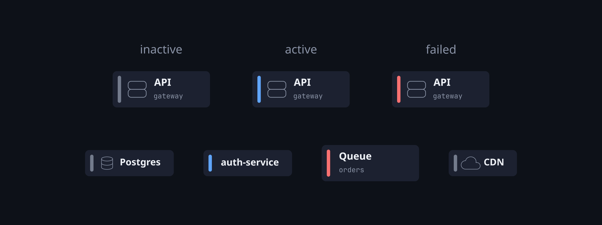

# Node

The box for one thing in an architecture diagram, in [node.py](node.py): a service, a database, a client, a queue. It is a card with an icon, a name and a second line, and a bar down its left edge that shows its status by color. Only the bar changes: the card, icon and text stay as they are.

Copy `node.py` and the skill's [icons.py](../../icons.py) and [code_font.py](../../code_font.py) next to the scene:

```python
from node import Node

api = Node("API", "gateway", icon="tabler/outline/server")
db = Node("Postgres", "primary", icon="tabler/outline/database").next_to(api, RIGHT, buff=1.5)
self.play(FadeIn(api, scale=0.9), FadeIn(db, scale=0.9))
self.play(api.to("active"))
self.play(db.to("failed"))
```



## Status

| Status | Bar |
|---|---|
| `"inactive"` | Grey. The default. |
| `"active"` | Blue. |
| `"failed"` | Red. The node also shakes once as it fails. |

`node.to(status)` returns the animation of the change, which takes 0.4 s (0.75 s for a failure, with its shake). It starts from whatever color the bar is when it begins, so changes can be played one after another or cut short. `node.set_status(status)` changes it at once, and `node.status` is the current one.

Use `"active"` to point at the node the narration is about, and return it to `"inactive"` when the attention moves on.

## Options

`Node(name, sub=None, icon=None, status="inactive", width=None)`

| Option | Effect |
|---|---|
| `name` | The node's name. |
| `sub` | A second, smaller line in the code font: a role, a host, a version. Without one the card is shorter. |
| `icon` | An icon id from the skill's library. Without one the text starts after the bar. |
| `status` | The status it starts in. |
| `width` | The card's width: by default 2.3 with a second line and 1.5 without, and wider when the text needs it. Give nodes that sit together the same width. |

A node is an ordinary group. Place it with `move_to` and `next_to`, resize it with `scale`, bring it in with `FadeIn(node, scale=0.9)`, and join nodes with the [line component](../line/README.md): `Connector(api, db)` starts and stops just outside the cards. Its parts are `node.card`, `node.bar`, `node.icon`, `node.name` and `node.sub`.

Don't play `node.to(...)` together with another animation of the same node, such as `node.animate.shift(...)`: both would set the bar's color and the result is undefined. Play them one after the other.

## Regenerating the image

```bash
manim render -s -r 2400,900 --disable_caching --media_dir /tmp/manim/node -o node examples.py Still
cp /tmp/manim/node/images/examples/node.png images/
```

`examples.py` also has `Demo`, which plays each status change and then a small diagram of nodes joined by lines.
