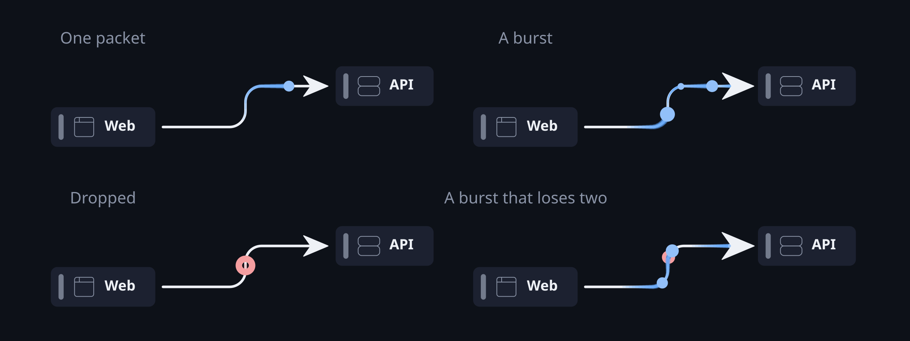

# Packet

Packets that travel along a line, in [packet.py](packet.py): a request, a reply, an event, a stream of traffic. Each is a dot with a comet's tail, on a `Connector` from the [line component](../line/README.md).

Copy `packet.py` next to the scene, with the line component's `line.py`:

```python
from line import Connector
from packet import send

link = Connector(web, api)
self.add(link)
self.play(send(link))                          # one packet
self.play(send(link, count=6))                 # a burst
self.play(send(link, drop=True))               # one that is lost part-way
self.play(send(link, count=6, drop=[1, 4]))    # a burst that loses its second and fifth
```



`send` returns an animation. The line must already be on screen.

## What a packet does

- **Sets off and lands.** It grows out of the start of the line, follows every elbow, and shrinks into the tip. Its tail runs in after it.
- **The tip swells.** Each packet that arrives makes the arrow's tip swell and settle, so a burst makes it throb.
- **A burst** is `count` packets setting off `gap` seconds apart. They differ in size, each swells and shrinks as it travels, and their tails are shorter so that they read as separate packets.
- **A dropped packet** stops where it is on the line, turns red and pops: it swells while a hole opens in its middle and widens until nothing is left. Its tail closes up behind it, and the tip does not swell for it.

## Options

`send(link, count=1, drop=False, drop_at=None, reverse=False, color=BLUE, size=1.0, travel=None, gap=0.14, branch=None)`

| Option | Effect |
|---|---|
| `count` | How many packets. More than one is a burst. |
| `drop` | `True` loses the packet, or every packet of a burst. A list loses just those packets, counting from 0, while the rest arrive: `drop=[1, 4]`. |
| `drop_at` | How far along a packet is lost, from 0 to 1. By default just past half-way for one packet, and a different place for each packet of a burst. |
| `reverse` | Travel from the line's end back to its start, for a reply. Give it another `color` to tell it from the request. |
| `color` | The packets' color. |
| `size` | 1 is the usual size. |
| `travel` | Seconds each packet takes. By default it depends on the line's length, at about 3.4 units a second. |
| `gap` | Seconds between the packets of a burst. |
| `branch` | On a fork, the one arm to travel. By default a packet goes down every arm, splitting where they part. |

The animation lasts as long as the packets need: the travel time, plus the gaps of a burst, plus half a second for the last tail to run in. A `run_time` given to `play` stretches or squeezes the whole thing.

Several sends can play at once, on different lines or on the same one: `self.play(send(a), send(b, reverse=True))`. To show a node receiving, change its status after the send: `self.play(send(link))` then `self.play(api.to("active"))`.

A packet arriving at an end with no tip (a `reverse` send on a one-way arrow, or a line made with `tip=False`) runs to the end of the line and nothing swells.

## Regenerating the image

```bash
manim render -s -r 2400,900 --disable_caching --media_dir /tmp/manim/packet -o packet examples.py Still
cp /tmp/manim/packet/images/examples/packet.png images/
```

`examples.py` also has `Demo`, which plays each kind of send and then a request travelling through a small diagram and its reply coming back.
