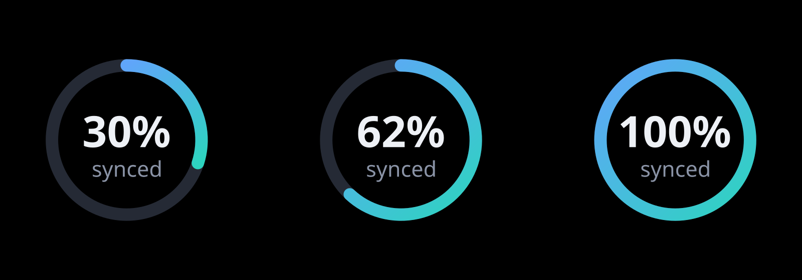
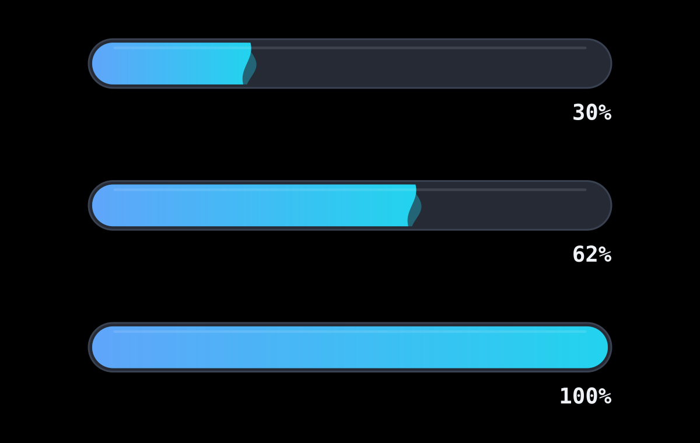
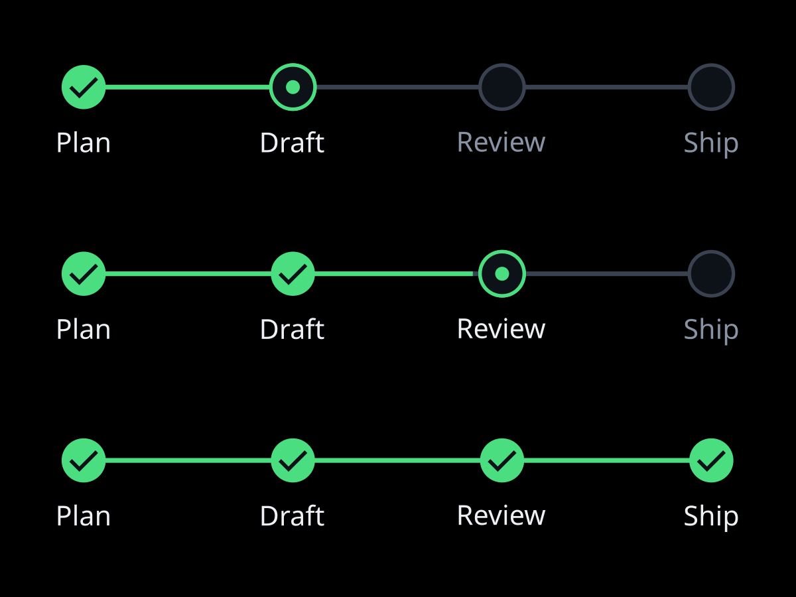
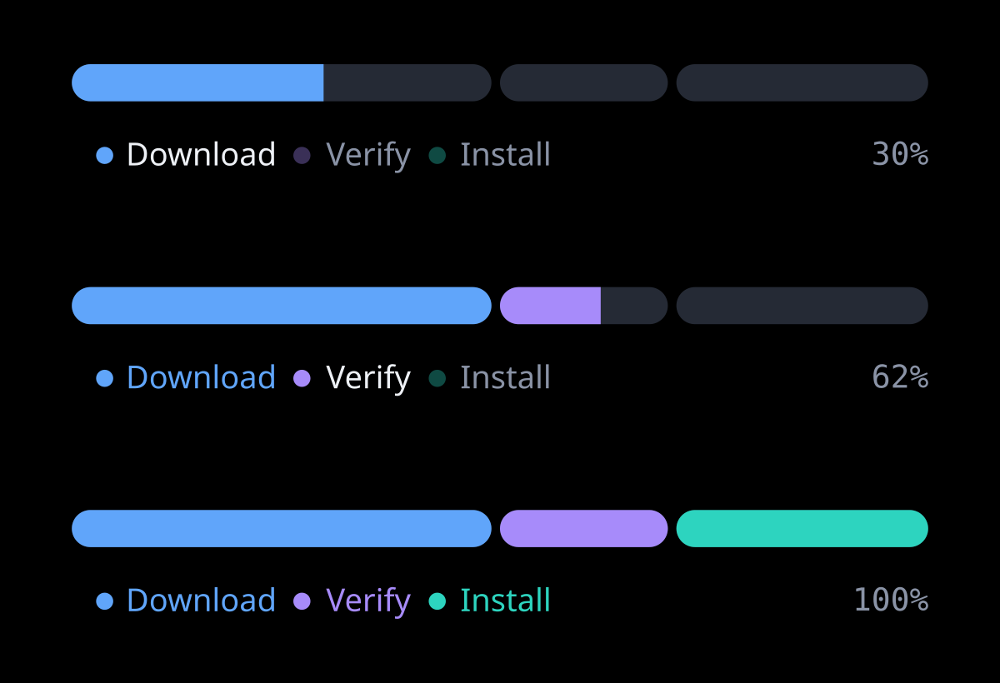
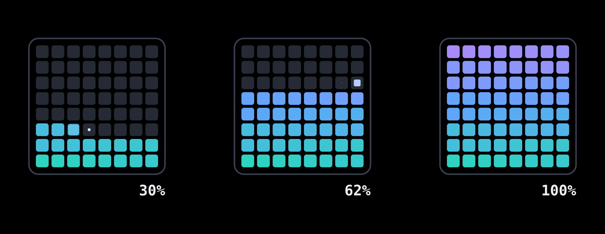
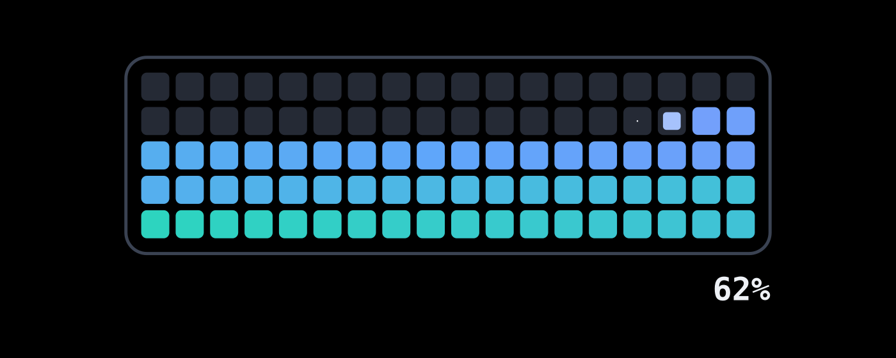

# Progress indicators

Live progress indicators for a scene, in [progress.py](progress.py). Each one redraws from a `ValueTracker` holding progress from 0 to 1, so animating the tracker animates the indicator, with ambient motion (waves, pulses) of its own.

Copy `progress.py` next to the scene, and also the skill's [icons.py](../../icons.py) when you use `stepper`:

```python
from progress import grid_fill, liquid, phases, ring, stepper

done = ValueTracker(0)
bar = liquid(done, width=5).to_edge(DOWN)
self.play(FadeIn(bar))
self.play(done.animate.set_value(0.8), run_time=3)
```

**Finishing is an event.** When the tracker reaches 1, the indicator celebrates for about a second. It springs (a quick swell that settles with a wobble), flashes white, and sends out a shockwave and a burst of sparks. Each one does this its own way, as described below. Give the scene that second (`self.wait(1)`) before moving on or fading it out. An indicator created already full shows as settled and doesn't celebrate. One that drops below 1 and returns celebrates again.

Set the size with the function's arguments, then place the result with `move_to`, `next_to`, `to_edge` or `shift`. Don't `scale` or `Transform` it, because the next redraw undoes that. To show different progress, animate the tracker. Several indicators can share one tracker.

Each image below shows 30%, 62% and 100%.

## ring

`ring(tracker, radius=0.72, thickness=12, colors=(TEAL, BLUE), caption="synced")`

A circle that fills clockwise from the top, with the percentage in the middle. Pass `caption=None` to leave out the word under the number. When done, the ring pops, flashes white, and sends a shockwave and a full circle of sparks outwards.



## liquid

`liquid(tracker, width=4.8, height=0.56, colors=(BLUE, CYAN), show_percent=True)`

A glass tube that fills from the left, with a rolling wave at the front of the liquid. When done, the waves settle flat, the liquid flashes, the tube pops, and a splash of sparks bursts off the far wall inside a shockwave.



## stepper

`stepper(tracker, steps=("Plan", "Draft", "Review", "Ship"), width=4.8, color=GREEN)`

Named stages on a line. A stage gets a check once progress passes it, and the first unchecked stage pulses as the current one. Stage `i` sits at progress `i / (len(steps) - 1)`, so set the tracker to that value to land on it. The last stage is checked at 100%. When done, the line flashes and the checks hop one after another. The last check lands with a shockwave and sparks.



## phases

`phases(tracker, parts=(("Download", BLUE, 0.5), ("Verify", VIOLET, 0.2), ("Install", TEAL, 0.3)), width=4.8, show_percent=True)`

One bar split into named phases, each given as `(name, color, share)`. Shares are normalized. The phases fill in order, and the legend lights the active phase in white and finished phases in their own color. When done, the bar flashes and pops, a shockwave rings out, and sparks fly off the end.



## grid_fill

`grid_fill(tracker, rows=8, cols=8, cell=0.22, gap=0.05, colors=(TEAL, BLUE, VIOLET), trail=3.0, show_percent=True)`

A box that fills with small squares from the bottom row up. The fill sweeps left to right, then right to left, and so on. Squares grow in over `trail` cells, so the fill's leading edge is a soft wave, and the squares still growing glow white. Leave rows and columns equal for a square, or set `cols > rows` for a wide box. When done, a ripple runs out from the last square, briefly swelling and whitening each square it passes. The frame lights up in the last color and sends out a double shockwave.




## Writing another live mobject

`live(draw, tracker)` turns any `draw(p, t, since) -> VGroup` into one of these. `p` is the progress, `t` is a clock in seconds, and `since` is the seconds since progress reached 1, or `None`. The completion helpers `_spring`, `_flash`, `_shockwave` and `_sparks` take `since`, so a new indicator can celebrate the same way. Use it instead of `always_redraw` for anything whose parts come and go while a `play()` runs. During a `play()`, the Cairo renderer only draws the mobjects that existed when the `play()` began. Parts that `always_redraw` creates later, such as a fill that appears once progress passes 0, or a percentage that gains a digit, never show, and the old parts stay on screen. `live` works around that.

## Regenerating the images

From this directory:

```bash
O=/tmp/manim/progress-examples
manim render -s -r 1600,560 --media_dir $O -o ring examples.py Ring
manim render -s -r 1600,620 --media_dir $O -o grid-fill examples.py GridFill
manim render -s -r 1400,560 --media_dir $O -o grid-fill-wide examples.py GridFillWide
manim render -s -r 1200,760 --media_dir $O -o liquid examples.py Liquid
manim render -s -r 1200,900 --media_dir $O -o stepper examples.py Stepper
manim render -s -r 1200,820 --media_dir $O -o phases examples.py Phases
cp $O/images/examples/*.png images/
manim render -qm --media_dir $O -o demo examples.py Demo   # all of them filling, finishing in turn
```
