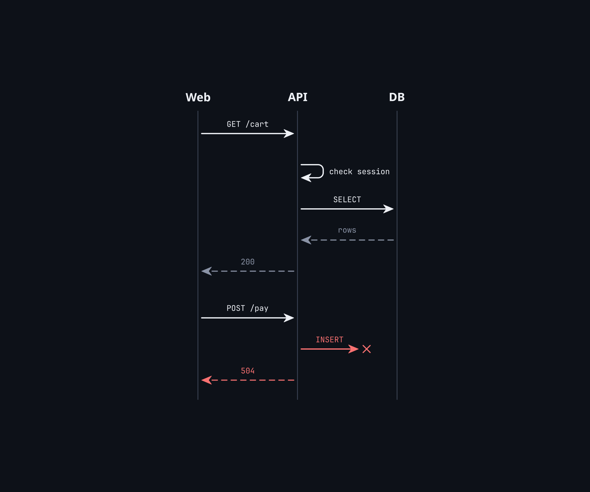

# Sequence

A sequence diagram, in [sequence.py](sequence.py): who says what to whom, in order, down the page. The participants' names run across the top, each with a lifeline below it, and each message is an arrow from one lifeline to another.

Copy `sequence.py` and the skill's [code_font.py](../../code_font.py) next to the scene:

```python
from sequence import Sequence

seq = Sequence("Web", "API", "DB")
self.play(seq.draw())                                   # the names and their lifelines
self.play(seq.send("Web", "API", "GET /cart"))          # a request
self.play(seq.send("API", "DB", "SELECT"))
self.play(seq.reply("DB", "API", "rows"))               # a reply
self.play(seq.reply("API", "Web", "200"))
self.play(seq.send("API", "DB", "INSERT", lost=True))   # one that never arrives
self.play(seq.reply("API", "Web", "504", error=True))   # a failure
```



Each call puts its message on the next row down and returns the animation that draws it.

## Messages

| Call | Looks like |
|---|---|
| `seq.send(a, b, label)` | A request: a solid white arrow with its label above it. |
| `seq.reply(a, b, label)` | A reply: a dashed grey arrow. |
| `seq.reply(a, b, label, error=True)` | A failure: a dashed red arrow. |
| `seq.send(a, b, label, lost=True)` | A message that never arrives: it gets part of the way, and after a moment turns red and is marked with a cross. |
| `seq.send(a, a, label)` | A step a participant does by itself: a small loop out and back, with the label beside it. |

`a` and `b` are participants' names, or their positions counting from 0. A message may pass over the lifelines between them.

Each arrow draws across in about half a second, tip leading, and its label comes in as it passes the middle. `seq.skip()` leaves a row empty before the next message, to separate one exchange from the next; `seq.skip(0.5)` leaves half a row.

`seq.draw()` brings in the names and grows the lifelines; it adds the diagram to the scene.

## Options

`Sequence(*names, spacing=2.4, row=0.75, rows=None, size=1.0)`

| Option | Effect |
|---|---|
| `names` | The participants, left to right. |
| `spacing` | The distance between lifelines. Widen it for long labels. |
| `row` | The distance between messages. |
| `rows` | How many messages to leave room for. Given this, the lifelines are drawn to their full length from the start and the diagram's size never changes, so it can be centred once. Without it the lifelines grow down as messages are added. |
| `size` | Scales the text, arrow tips and line weights. |

The diagram is made with the first name at the origin. Place it with `move_to`, `to_edge` or `shift` before adding messages; `seq.move_to(UP * 3.3, aligned_edge=UP)` hangs it from near the top of the frame. Don't `scale` it: set `size`, `spacing` and `row` instead.

Labels are set in the skill's code font. Its parts are `seq.names`, `seq.lifelines` and `seq.messages`.

## Regenerating the image

```bash
manim render -s -r 1800,1500 --disable_caching --media_dir /tmp/manim/sequence -o sequence examples.py Still
cp /tmp/manim/sequence/images/examples/sequence.png images/
```

`examples.py` also has `Demo`, which builds the diagram above one message at a time.
