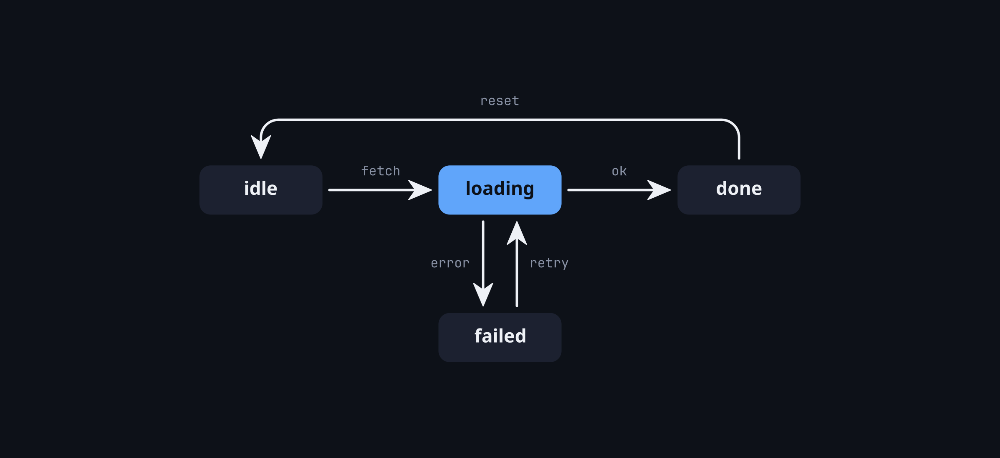

# State machine

A state machine, in [states.py](states.py): named states as solid chips, one of them current, and transitions that fire along the arrows between them.

Copy `states.py` next to the scene, with the line component's [line.py](../line/line.py) and the skill's [code_font.py](../../code_font.py):

```python
from states import StateMachine

m = StateMachine(
    {"idle": (-3.4, 0.6), "loading": (0, 0.6), "done": (3.4, 0.6), "failed": (0, -1.5)},
    [("idle", "loading", "fetch"), ("loading", "done", "ok"), ("loading", "failed", "error"),
     ("failed", "loading", "retry"), ("done", "idle", "reset")],
    bad=["failed"])
self.play(m.draw())
self.play(m.fire("fetch"))        # idle -> loading
self.play(m.fire("error"))        # loading -> failed
```



## Running it

- **The current state** is a chip filled with blue, its name in dark text. States listed in `bad` fill with red instead.
- **`m.fire(label)`** fires the transition with that label out of the current state, and returns the animation: the state it leaves goes dark, the arrow and its label light up blue, and the state it reaches fills. It takes 0.75 s. Where two arrows out of a state share a label, name the one you mean by its ends: `m.fire(("loading", "done"))`.
- Firing a transition that does not leave the current state raises an error that lists the ones that do, so a script cannot drift out of step with the machine.
- **`m.draw()`** brings the machine in: the chips, then the arrows growing between them, then the starting state lighting up.
- **`m.set_state(name)`** makes a state current at once, with no animation. `m.current` is the current state's name.

## Laying it out

You say where each state goes; the arrows route themselves:

| Between two states | The arrow |
|---|---|
| Level with each other, or one above the other | Runs straight. |
| The same, with another state in the way | Goes over it (the first such arrow) or under it (the next), in elbows. |
| With an arrow coming back the other way | The two run side by side, each to the right of its own direction, with their labels on the outer sides. |
| Neither level nor above each other | Turns through elbows. |
| A state and itself | Loops out of the top and back. |

A label sits above a level run, and to the right of an upright one. To route an arrow yourself, give its transition a fourth item, a dict of options for the line component's `Connector`: `("done", "idle", "reset", {"route": "u", "side": DOWN, "reach": 0.8})`.

## Options

`StateMachine(states, transitions, start=None, bad=(), spacing=3.2, size=1.0)`

| Option | Effect |
|---|---|
| `states` | `{name: (x, y)}`. A plain list of names is laid out in a row, `spacing` apart. A chip is 0.7 tall and at least 1.75 wide, so leave about 3.2 between neighbours for an arrow and its label, and 2 between rows. |
| `transitions` | `(from, to, label)` for each arrow. |
| `start` | The state that is current to begin with; by default the first. |
| `bad` | States that light red when current. |
| `size` | Scales the chips, text and arrows. Don't `scale` the machine. |

Place the whole machine with `move_to` or `shift`. Its parts are `m.chips[name]`, and `m.arrows[key]` and `m.labels[key]` where `key` is the `(from, to, label)` of a transition.

## Regenerating the image

```bash
manim render -s -r 2400,1100 --disable_caching --media_dir /tmp/manim/states -o states examples.py Still
cp /tmp/manim/states/images/examples/states.png images/
```

`examples.py` also has `Demo`, which draws the machine above and fires each of its transitions.
