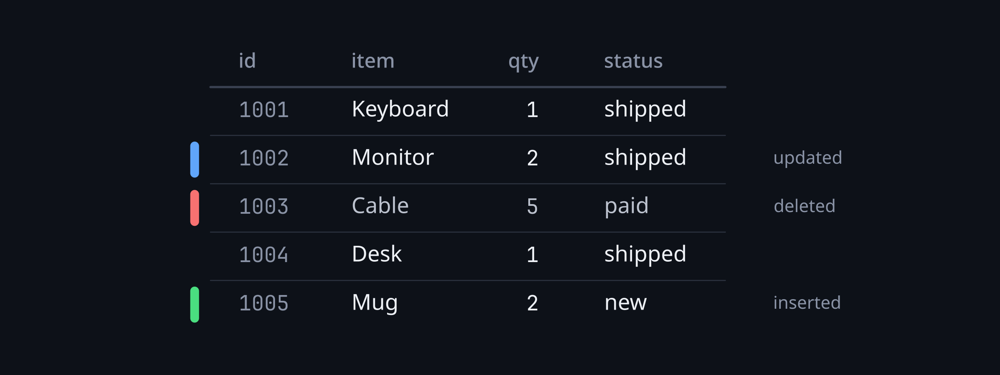

# Table

A table of records, in [table.py](table.py): column names over a rule, a row for each record, and a bar at the left of a row whenever it is inserted, updated or deleted.

Copy `table.py` and the skill's `code_font.py` next to the scene.

```python
from table import DataTable

t = DataTable(["id", "item", "qty", "status"],
              [["1001", "Keyboard", 1, "shipped"],
               ["1002", "Monitor", 2, "paid"],
               ["1003", "Cable", 5, "paid"]])
self.play(t.draw())
self.play(t.insert_row(["1004", "Desk", 1, "new"]))    # opens at the bottom, marked green
self.play(t.update_row("1002", status="shipped"))      # marked blue while the value changes
self.play(t.delete_row("1003"))                        # marked red, then closes up
```



The class is `DataTable` because Manim has a `Table` of its own, and the methods end in `_row` because every Manim object already has an `insert` and an `update`.

## What it shows

- **Inserted:** the row opens up, pushing the rows below it down, with a green bar.
- **Updated:** the row gets a blue bar while each old value slides up and out and the new one comes up into its place.
- **Deleted:** the row gets a red bar and its text dims; a moment later it closes up.

The bar is the only mark: nothing else on the row changes color. It goes out by itself at the end of the move.

## Moves

Each returns an animation to play.

| Call | Effect |
|---|---|
| `t.draw()` | The entrance: the rule is drawn under the column names and the rows fade in from the top down. `FadeIn(t)` also works. |
| `t.insert_row(values, at=None)` | A new row, at the bottom, or at position `at` (0 is the top). |
| `t.update_row(row, status="shipped", qty=3)` | Change one or more values in a row. For a column whose name is not a word, pass a dictionary: `t.update_row(row, {"unit price": "4.50"})`. |
| `t.delete_row(row)` | Remove a row. |
| `t.mark(row, color=BLUE)` | Light a row's bar without changing the row (the one a query is reading, say). It stays lit. |
| `t.unmark(row=None)` | Put out one row's bar, or every bar that is lit. |

Wherever a `row` is asked for, a number is the row's position from the top, counting from 0, and a string is looked up in the key column: `t.delete_row(0)` removes the first row and `t.delete_row("1003")` the one whose id is 1003.

`insert_row`, `update_row` and `delete_row` take `hold`, the seconds the bar stays lit (0.8; 0.6 before a deleted row closes). `hold=None` leaves the bar lit until `unmark`, which is useful when narration needs to dwell on the change. They also take `color`, and every move takes `run_time`.

Moves can be made ahead of being played, so `Succession(t.insert_row(...), t.update_row(...))` works, and two rows can change at once: `self.play(t.update_row(0, qty=2), t.update_row(1, qty=4))`.

## Options

`DataTable(columns, rows=(), key=0, right=None, mono=None, widths=None)`

| Option | Effect |
|---|---|
| `columns` | The column names. |
| `rows` | The records to begin with: a list of values for each, in column order. |
| `key` | The column that names a row, by name or position. It is drawn muted and is what a string `row` is looked up in. The first column by default; `None` for a table without one. |
| `right` | The columns to align right. By default, those whose first values are numbers (`2`, not `"2"`). |
| `mono` | The columns to set in the code font. By default, those whose first values have no letters in them: ids, counts, prices, times. |
| `widths` | `{column: width}` for a column that needs more room than its first values take. Columns are sized once, from the rows the table is made with, so give a width when a longer value will arrive later, and give `right` and `mono` when the table starts empty. |

`t.cell(row, column)` is the text of one value, for pointing an arrow or a callout at. `t.count` is the number of rows; `t.header`, `t.rule` and `t.body` are its parts.

A table is an ordinary group: place it with `move_to` or `next_to` and resize it with `scale`. Its rule stays where it is while rows open and close below it, so leave room underneath for the rows to come, and about 0.3 to the left for the bars.

## Regenerating the image

```bash
manim render -s -r 2400,900 --disable_caching --media_dir /tmp/manim/table -o table examples.py Still
cp /tmp/manim/table/images/examples/table.png images/
```

`examples.py` also has `Demo`, which draws an orders table and then inserts, updates, deletes and marks rows.
