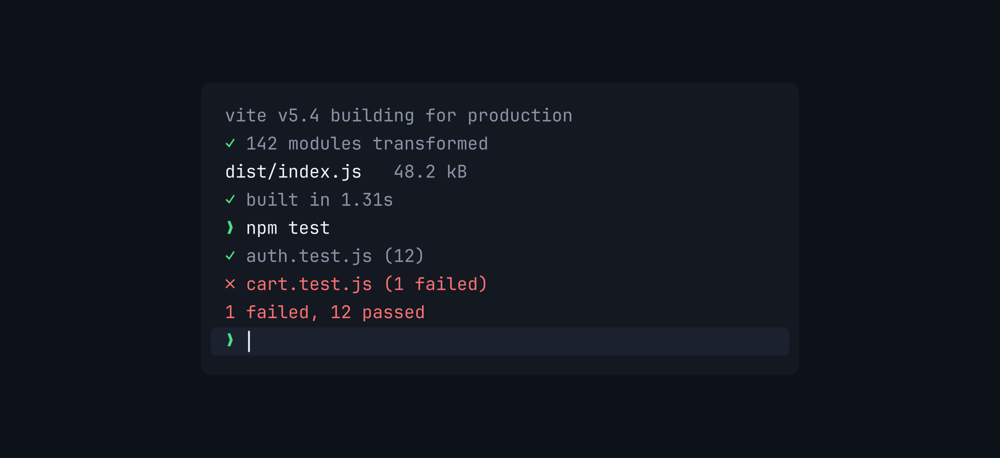

# Terminal

A terminal, in [terminal.py](terminal.py): commands typed at a prompt, and their output arriving line by line. It is a plain panel of text in the code font; the line being typed has a band behind it.

Copy `terminal.py` and the skill's [code_font.py](../../code_font.py) next to the scene:

```python
from terminal import Terminal, fail, ok

term = Terminal()
self.play(FadeIn(term))
self.play(term.type("npm run build"))
self.play(term.output("vite v5.4 building for production",
                      ok("142 modules transformed"),
                      ok("built in 1.31s")))
self.play(term.run("npm test", ok("auth.test.js (12)"), fail("cart.test.js (1 failed)")))
```



## Using it

Each of these returns an animation to `play`:

| Call | Effect |
|---|---|
| `term.type(command)` | Types the command at the prompt, a character at a time, with the cursor following. |
| `term.output(*lines)` | The band and cursor go away while the command runs; each line fades in half a second after the one before; then the prompt comes back on a new line. `gap` changes the half second, and `prompt=False` leaves the prompt out. |
| `term.run(command, *lines)` | Both: types the command, pauses as if pressing Enter, and shows its output. |

A line of output is one of:

- **a string**, set in grey;
- **`ok(text)`**, a green tick and the text;
- **`fail(text)`**, a red cross and red text;
- **a list of `(text, color)` parts**, for anything else: `[("dist/index.js", INK), ("   48.2 kB", MUTED)]`. Each part starts at the column where the one before it ends.

The cursor is a bar. It holds steady while a command is typed and blinks when nothing is happening. When more lines arrive than the terminal holds, the text scrolls up and the top lines fade out.

## Options

`Terminal(width=7.0, lines=8, prompt="❯", size=1.0)`

| Option | Effect |
|---|---|
| `width` | The panel's width. Lines are not wrapped, so keep them shorter than this: at the usual size a character is about 0.15 wide. |
| `lines` | How many lines the panel holds, which sets its height. |
| `prompt` | What a command line begins with, drawn in green. |
| `size` | Scales the text and spacing. Don't `scale` the terminal. |

Bring the terminal in with `FadeIn` and place it with `move_to`, `next_to` or `shift`. Its parts are `term.panel`, `term.band`, `term.cursor` and `term.text`.

This is for a session at a shell. For a file of source code, use `Code` (see [references/code.md](../../references/code.md)).

## Regenerating the image

```bash
manim render -s -r 2400,1100 --disable_caching --media_dir /tmp/manim/terminal -o terminal examples.py Still
cp /tmp/manim/terminal/images/examples/terminal.png images/
```

`examples.py` also has `Demo`, which runs a build, a failing test run, and one more command that makes the text scroll.
