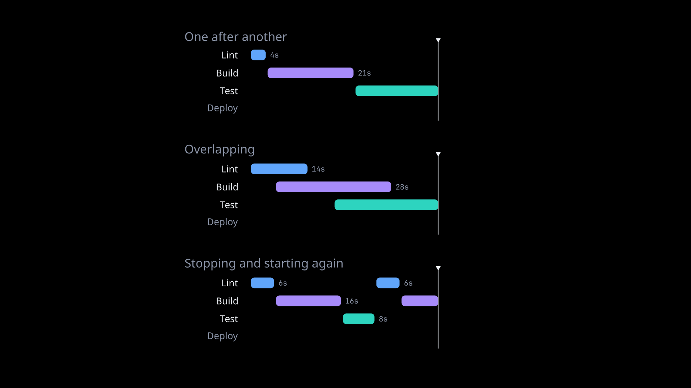

# Timeline

A timeline of named rows whose bars fill as time passes, in [timeline.py](timeline.py). It shows when things happen relative to each other: jobs that run one after another, work that overlaps, a task that stops and starts again.

Copy `timeline.py` and the skill's [code_font.py](../../code_font.py) next to the scene:

```python
from timeline import timeline

now = ValueTracker(0)
chart = timeline(now, [
    ("Lint", (0, 14)),
    ("Build", (6, 34)),                  # starts before Lint ends: they overlap
    ("Test", [(20, 31), (36, 44)]),      # two runs in one row, with a pause between
    ("Deploy", (44, 50)),
])
self.add(chart)
self.play(now.animate.set_value(50), run_time=6, rate_func=linear)
```



`now` is a `ValueTracker` holding the time the cursor is at, in the same units as the bars. Animate it to run the timeline. Use `rate_func=linear` so time passes evenly.

Each row is `(name, bars)`. `bars` is one `(start, end)`, or a list of them for work that stops and starts again. Rows are independent, so their bars can overlap in time in any way.

Nothing of a bar shows before its time. A bar appears as the cursor reaches its start and grows with the cursor. When it finishes, its duration pops out: it slides out from behind the bar's end, growing a little past full size before it settles, which takes 0.4 s. The duration goes beside the bar when there is room before the row's next bar, inside the bar when there isn't, and is left out when neither fits. A row's name brightens when its first bar starts.

A timeline made with `now` already past some bars shows their durations settled, without the pop. Leave half a second after the last bar finishes before fading the timeline out.

`timeline(now, rows, width=4.5, row_gap=0.37, bar=0.22, colors=(...), unit="s", span=None, durations=True, cursor=True, label_size=14)`

| Option | Effect |
|---|---|
| `width` | The length of the time axis. The bars are centred where you put the timeline, and the row names hang off the left. |
| `row_gap`, `bar` | The distance between rows and the height of a bar. |
| `colors` | One per row, repeating. |
| `unit` | Written after each duration (`"s"`, `" min"`). `durations=False` leaves the durations out. |
| `span` | `(first, last)` time shown. By default, from the earliest start to the latest end. |
| `cursor` | `False` hides the line that marks `now`. |

Place it with `move_to`, `next_to` or `shift`. Don't `scale` it: the next redraw undoes that.

## Regenerating the image

```bash
manim render -s -qh --disable_caching --media_dir /tmp/manim/timeline -o timeline examples.py Still
cp /tmp/manim/timeline/images/examples/timeline.png images/
```

`examples.py` also has `Demo`, the three timelines running.
