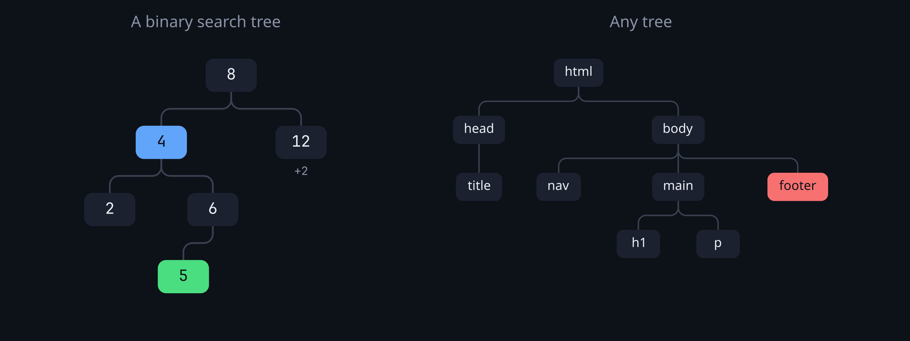

# Tree

A tree, in [tree.py](tree.py): values on chips, each joined to its parent by a line that turns in elbows. Nodes are added and removed, branches fold away and open again, and the rest of the tree moves over to make room. It draws a binary search tree, or any other hierarchy: a page's elements, an org chart, a parse tree.

Copy `tree.py` and the skill's `code_font.py` next to the scene.

```python
from tree import Tree

t = Tree({8: [4, 12], 4: [2, 6], 12: [10, 14]}, binary=True)    # parent: its children
self.play(t.draw())
self.play(t.visit(8, 4, 6))            # each lights in turn
self.play(t.add_node(5, 6))            # a line grows from 6, and 5 appears, marked green
self.play(t.insert_value(11))          # a search tree finds the place itself
self.play(t.fold(4))                   # the branch under 4 goes into it, leaving "+3"
self.play(t.unfold(4))
self.play(t.remove_node(14))           # marked red, then gone
```



## What it shows

- **A node** is a chip with its value. Numbers are set in the code font and words in the text font, and a chip widens to fit a long word.
- **A lit node** has its chip filled: blue while a search passes through it or when marked, green when it has just been added, red when it is about to go. Nothing else changes color.
- **A folded node** has a small count under it, such as "+3", of the nodes hidden inside it.
- **The tree makes room.** When a node is added or removed, or a branch folds or opens, every other node slides to its new place. The root stays where it is.

## Moves

Each returns an animation to play. A node is named by its value.

| Call | Effect |
|---|---|
| `t.draw()` | The entrance: the root appears, then each level's lines grow down and its chips appear. `FadeIn(t)` also works. |
| `t.add_node(value, parent)` | A new node under `parent`: a line grows down to its place and the chip appears, lit green. In a binary tree, `side="left"` or `"right"`; left out, a value smaller than its parent goes left and any other right. Otherwise `at` is its place among the parent's children (the last by default). |
| `t.insert_value(value)` | For a binary search tree: goes down from the root, left for smaller and right for larger, lighting each node passed, and adds the value where the way down runs out. |
| `t.remove_node(value)` | The node is lit red, then goes with everything under it; its line draws back and the tree closes up. |
| `t.fold(value)` | Everything under the node slides into it and the tree closes up. |
| `t.unfold(value)` | The branch comes back out. |
| `t.visit(*values, each=0.5)` | Lights nodes one after another, `each` seconds apart; each goes out as the next comes on. |
| `t.mark(value, color=BLUE)` | Lights a node and leaves it lit. |
| `t.unmark(value=None)` | Puts out one node, or every node that is lit. |

`add_node` takes `hold`, the seconds the new chip stays green (0.8); `hold=None` leaves it lit until `unmark`. `remove_node` takes `hold`, the seconds it is red before it goes (0.5). Both take `color`, and every move takes `run_time`.

Moves can be made ahead of being played, so `Succession(t.add_node(5, 6), t.fold(4))` works.

Add under a folded node only after unfolding it; `add_node` says so otherwise.

## Options

`Tree(children, binary=False, spacing=None, level=1.05)`

| Option | Effect |
|---|---|
| `children` | `{parent: [its children]}`, with an entry for every node that has children. The root is the node that is nobody's child. A single value, `Tree(8)`, is a tree of one node to grow from. Values must differ from one another. |
| `binary` | `True` for a binary tree. Every node then has a left and a right place: an only child sits to its side instead of straight below, and `{6: [None, 7]}` is a node with only a right child. |
| `spacing` | The distance between neighbouring nodes. By default, the width of the widest chip the tree starts with, plus a gap. Give it when wider values will be added later. |
| `level` | The distance from one level down to the next. |

`t.chip(value)` is one node's chip and text, for pointing an arrow or a callout at. `t.links` and `t.chips` are the tree's parts.

A tree is an ordinary group: resize it with `scale`. It is laid out from its root, which stays put while the tree changes, so place it by the root, for example `t.shift(UP * 3 - t.chip(8).get_center())`, and leave room below and to both sides for what will be added.

## Regenerating the image

```bash
manim render -s -r 2400,900 --disable_caching --media_dir /tmp/manim/tree -o tree examples.py Still
cp /tmp/manim/tree/images/examples/tree.png images/
```

`examples.py` also has `Demo`, which searches, grows, folds and prunes a binary search tree, then does the same to a tree of a page's elements.
